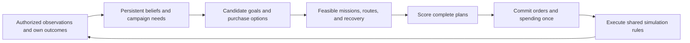

# CPU play plan

Status: staged design with an initial basic CPU implementation, 2026-11-07. [GAMEPLAY_STATE.md](./GAMEPLAY_STATE.md) is the source of truth for implemented behavior; the broader systems below remain the design target.

## Basic implementation checkpoint

The current branch implements a campaign entry menu with saved Easy/Medium/Hard selection, persistent CPU forces and finite repair/replacement spending, recovery-gated site and traffic memory, stored mission orders, defense/patrol/escort/strike selection, bounded direct/flank route alternatives, support-site strikes, private sensing, and CPU recon RTB. Checks cover deterministic adaptation, information isolation, save/load, and complete recon-to-strike sequences on all tiers.

This is a basic subset of the milestones below. CPU construction, upgrades, FOB staging, terrain/boundary recovery, confirmed-kill income, graph-search routing, and Hard campaign lookahead remain future work. The fixed maintenance priority is a baseline heuristic rather than the proposed joint mission/purchase evaluator. No browser testing has been performed.

## Goal and first-pass scope

Build a CPU opponent that gathers information, chooses a campaign objective, assigns its available aircraft, plans feasible routes, spends a finite budget, and changes its next plan when evidence shows that its previous approach failed. Easy, Medium, and Hard should differ in planning quality and coordination.

The first complete pass must include reconnaissance, fighter defense and escort, ground strikes against confirmed sites, persistent losses, repairs and replacements, defense construction, upgrade evaluation, FOB construction and staging, and adaptation across rounds. Deliver these through the milestones below; difficulty selection alone is not a completed CPU opponent.

Keep the current six-round campaign and starting forces as the initial balance baseline. In particular, the CPU begins with its existing one four-aircraft fighter formation and one two-aircraft recon formation. Its single fighter creates a real choice between strike, defense, patrol, and escort. Additional formations and new aircraft types require a separate balance decision.

## Isolation and baseline

- Worktree: `/private/tmp/air_power_game-cpu-play-plan`.
- Branch: `cpu-play-plan`, created from `origin/main` at `41890c1`.
- Run every edit, Git command, and later implementation check from this worktree or a subsequent worktree created from this branch. Verify the working directory before mutations.
- The original `/Users/ryanclendening/Development/air_power_game` checkout remains on `cpu-strategy` with mixed uncommitted CPU prototype and other-chat edits. This planning change leaves that checkout untouched.
- The earlier uncommitted 80/60/40 difficulty-threshold prototype is not part of this baseline. Resolve its overlapping edits with the owner of the original checkout before merging later work. This plan proposes one shared intelligence gate across difficulties.
- Commit the plan on this branch so it has its own durable history. A branch name in a shared dirty checkout does not provide isolation.

## Current implementation and required foundations

| Area | Current behavior at the baseline | Required change |
| --- | --- | --- |
| Enemy forces | `engine.ts:enemyFlights` regenerates full formations each round. | Persist the CPU roster, strength, aircraft, reserves, and operating fields. |
| Intelligence | Enemy recon and fighters observe friendly fixed assets; recovered base/decoy observations affect persistent targeting pressure. | Maintain the CPU's own recovered mapping, site reports, uncertainty, and observed traffic history. |
| Missions and sensors | Enemy routes are scripted. Voluntary target selection, ground-radar receipts, escort, and several fuel/recovery checks are friendly-specific. | Share gameplay rules by side while retaining separate player visibility projections. |
| Ground strike | The enemy can launch only against the home base when exposure reaches 60. | Give CPU strike orders an explicit confirmed target and release point, including defense and FOB targets. |
| Spending | Economy commands and placement validators operate on the player's campaign state. | Expose the same quotes and validation against an explicit owning side; add a CPU ledger and settlement. |
| FOBs | Player construction, capacity, recovery, diversion, and trapping exist. Enemy flights have no equivalent operating-field lifecycle. | Apply those rules to CPU-owned fields and persistent formations. |
| Difficulty | No committed difficulty setting exists at this baseline. | Persist a profile controlling candidate evaluation and lookahead. |

Reference modules: [engine.ts](./src/game/engine.ts), [types.ts](./src/game/types.ts), [campaign.ts](./src/game/campaign.ts), [economy.ts](./src/game/economy.ts), [routeTemplates.ts](./src/game/routeTemplates.ts), [missionResponsibility.ts](./src/game/missionResponsibility.ts), [forwardBasing.ts](./src/game/forwardBasing.ts), and [persistence.ts](./src/game/persistence.ts).

## Decision architecture

Use a utility planner with a small set of mission templates, route search, and a purchase evaluator. Add bounded lookahead for Hard after immediate decisions are reliable. The continuous route space, simultaneous orders, and hidden information make exhaustive game-tree search a poor first implementation.

The strategic planner operates at phase boundaries. Tactical execution uses the existing reaction priority: destruction, direct combat, commanded/required recovery, authorized intercept, assigned mission. The CPU does not continuously rewrite campaign objectives at every simulation tick.

### Phase timing and determinism

1. At campaign creation, initialize CPU-owned state and search priors without inspecting player placements.
2. At round settlement, persist CPU attrition, recovery, recoverable intelligence, witnessed results, and income exactly once.
3. At entry to Adapt, decide and apply CPU purchases from that settled knowledge. Purchases cannot read the player's pending Adapt choices.
4. At entry to the next Plan phase, generate and store CPU orders before the player edits their orders. Freeze them for the round. A reload uses the stored plan rather than rerolling it.
5. During Execute, allow only mission reactions and authorized local commands, such as CPU recon RTB. New strategic ground targets wait for recovered intelligence and a later round.

Key settlement, spending, and order generation by campaign, round, and phase so repeated renders, phase transitions, or reloads cannot duplicate them. Use deterministic candidate order, stable identity tie breaks, and a CPU random stream separate from combat rolls. Bound search by candidate/expansion counts rather than elapsed time.

## Persistent CPU state and shared rules

Store a versioned CPU campaign record containing difficulty, roster, aircraft reserves, Logistics, income/spending history, owned assets and basing, mapped areas, boundary observations, recovered site reports, behavioral evidence, selected goal, committed orders, and the last settled/planned round.

Enemy fixed assets currently stored in `enemyAssets` remain authoritative; reference them from the CPU state rather than creating a second mutable copy. Keep player-facing `EnemyFlight` results as projections of the authoritative CPU roster and orders. Do not use sortie presentation objects as the campaign inventory.

Initially propose 10 Logistics, three reserve aircraft, and the same income/cost rules as the player. Preserve the existing asymmetric opening roster and existing enemy-site health values across all difficulties. These are balance assumptions to validate, not additional difficulty bonuses.

Extract explicit side views for mission validation, sensing, economy quotes, placement, and recovery. Audit each `friendly` conditional: some enforce gameplay ownership and need generalization; others intentionally protect player visibility. Avoid swapping player/enemy arrays into a whole `MatchState` and hoping every helper interprets them correctly.

The two-aircraft CPU recon needs an explicit strength/aircraft-capacity audit. Existing count conversion and replacement code contains four-aircraft/25-strength assumptions. Define strength per aircraft from formation capacity, and verify both two-aircraft and four-aircraft formations before enabling persistent CPU replacements.

Save migration must initialize an absent CPU record once from a documented legacy snapshot. Existing saves do not contain trustworthy historical enemy inventory, so do not reconstruct past losses from hidden results or reset forces on every reload. Retain deterministic tactical fixtures through their explicit fixture path.

## Knowledge and observation rules

Give the planner a sanitized `CpuPlanningView` containing its own state, public rules, authorized observations, and derived beliefs. It must not receive unrestricted `MatchState`, player orders, selected targets, purchase intent, hidden current positions, hidden site health, the player's resource ledger, or unrecovered map bounds.

- Start with a search distribution over scenario-permitted opposing regions. Do not read the real placed base coordinates or reverse world generation from its seed. The planner seed is for reproducible choices only.
- Recon and fighters collect site positions/types provisionally along their actual flight paths. Recovery commits those reports for next-round targeting. A lost flight does not reveal the sites or exact location/cause of its loss to the campaign planner.
- A missing flight is known to be missing. Its assigned corridor can become a coarse uncertainty/risk clue; the planner cannot use its hidden death position to locate a SAM.
- Current visual and radar contacts authorize tactical reactions. Radar-only contacts retain unknown role. Contact loss stops exact live tracking; old traffic becomes a distribution over sectors, not an intercept coordinate.
- An observed weapon launch can inform a local threat alert or uncertain threat region. It does not independently create a permanently confirmed strike target under the current reconnaissance rules.
- Recovered fixed-site coordinates persist. Confidence in health, operational state, and recent traffic ages separately; a stationary site's known coordinates should not disappear merely because a round passed.
- Opponent construction, repairs, upgrades, losses, and SAM ammunition are known only when observed or legitimately inferred. The CPU always knows its own inventory and ammunition.

Retain the current 60-point recovered base-pressure gate and decoy reduction initially, consistently across difficulties. Additional fixed-site targets require recovered confirmation. If pressure and the new site-report model overlap, document their separate responsibilities: pressure authorizes base targeting; reports provide the target knowledge. Any replacement of that campaign model is a separate mechanics decision.

## Objectives, force assignment, and scoring

Score complete feasible plans rather than scoring a target, a route, and a purchase independently and combining incompatible winners. Generate a small set of goal templates:

| Goal | When it has value | Typical assignment |
| --- | --- | --- |
| Find or refresh a target | Useful targets are unconfirmed, stale, or outside current reach. | Recon searches a selected sector or revisits a known site; fighter escorts only if feasible. |
| Protect the CPU base | Observed ingress or prior attacks threaten campaign survival. | Fighter Protect around home or an approach; defense repair/construction complements it. |
| Protect recon | Recovered evidence shows fighter opposition on an important collection route. | Fighter escorts recon within the existing speed, fuel, and coverage constraints. |
| Patrol an approach | Recent observed traffic offers an intercept opportunity. | Fighter Forward Patrol on that sector, with the normal pursuit limits. |
| Strike a confirmed site | Expected effect and recovery prospects justify using the fighter. | Fighter Ground Strike against an explicit base, defense, radar, or FOB target. |
| Stage or restore forces | Range, damage, missing aircraft, or an unusable field blocks a useful next mission. | Transit, repair/replacement, FOB repair, or justified construction; aircraft may remain grounded. |

The single fighter cannot escort recon and perform Ground Strike in the same sortie. If escort coverage is infeasible, shorten/change the recon mission or choose another plan. Do not create invisible reserve flights or promise protection that actual movement cannot provide.

Rank terminal campaign outcomes first, then expected effect, recovered information, surviving/recoverable forces, future reach, and Logistics remaining. Penalize expected damage/loss, uncertainty, fuel exposure, unsupported roles, and opportunity cost. Normalize score components before tuning weights. Account for rounds remaining and preserve a reserve when it supports a feasible future mission.

The CPU benefits from keeping its base alive through the six-round deadline; defending or conserving aircraft can be rational. Losing the CPU's aircraft does not itself become a new player victory condition. Avoid optimizing kill counts or Logistics income at the expense of the actual campaign outcome.

Keep the previous goal when scores are close. Switch promptly when a goal becomes infeasible or new evidence creates a substantial advantage. Record the triggering evidence and score change so adaptation can be inspected.

## Routes, strikes, and tactical defense

Use a bounded graph search over sampled hex centers for ingress alternatives, then convert the result into the existing route representation. Compare direct, flank, and lower-exposure approaches. Use exact segment lengths and sample risk along segments; a route with safe endpoints may still cross a defense envelope.

Fuel, aircraft availability, launch-field operability, recovery capacity, intelligence authorization, waypoint limits, and mission rules are hard feasibility checks. Threat exposure and mission payoff are scored tradeoffs. A* or bounded alternative-route search should keep distance and accumulated risk costs nonnegative; discard routes that fail the canonical route/recovery validator.

Respect the current fighter/recon mission allowances of 40/64, fixed speeds, mission patterns, five optional ingress waypoints, and explicit recovery reserve. Simplifying a searched path must recheck threat exposure and feasibility. Use the CPU's known planning envelope; execution still encounters unknown real world edges normally.

Estimate known SAM risk using range, expected time in range, three missiles, three-second cooldown, and observed ammunition uncertainty. Estimate AAA with its one attack per formation per round. Treat radar as detection/interception risk rather than direct damage. Use observed fighter traffic as uncertain future coverage, never as access to a hidden route.

For Ground Strike, select a confirmed target and a fixed release point within the existing six-unit range. Evaluate release-point alternatives together with ingress and recovery; there is no need to overfly the site. Preserve one payload, strength-scaled damage, physical release, delayed impact, and surviving launched missiles. A destroyed or invalid target does not cause an automatic replacement target to be chosen.

Generalize the existing ground-target launch and impact path so CPU attacks can damage player SAMs, AAA, radar, FOBs, and decoys as well as the base. Preserve damage persistence, airfield operational changes, diversion, trapping, and missile timing. Base-only victory accounting must not count damage to support sites as base damage.

CPU Protect, patrol, and escort use their normal responsibility, contact, pursuit, fuel, and posture rules. Make enemy radar receipts and aircraft visual sensing available privately to CPU formations. A strike fighter performs no voluntary air interception, while direct fighter combat still interrupts it.

Allow the CPU to issue the existing irreversible recon RTB decision when current authorized threats, remaining range, and the value of already collected information justify recovery. Use the same command acceptance/recovery semantics as the player. Preplan an alternate ingress next round rather than granting a new mid-flight strategic route-editing ability.

## Spending, upgrades, defenses, and FOBs

Enumerate legal quotes, including an explicit option to save. Compare short purchase sequences on a working copy, re-quote after every simulated purchase, and apply the selected sequence once through the authoritative economy commands. Check budget, aircraft reserves, placement knowledge, spacing, and upgrade exclusivity on every action.

| Action | Evaluation rule |
| --- | --- |
| Formation repairs/replacements | Value the missions restored and strength recovered, reserve-aircraft limits, and remaining campaign opportunities. A lost formation returns at home through a paid replacement. |
| SAM/AAA repair | Value operational coverage and the chance of protecting an important site. SAM ammunition already replenishes each round; buying a repair is not a rearm action. |
| New SAM/AAA | Sample legal owned/recovered hexes. Score predicted observed approaches, protected sites, overlapping coverage, ammunition limits, and survivability. Repeatedly stacking one approach has diminishing value. |
| Radar repair | Preserve useful detection/interception coverage. The present catalog has no radar-construction action, so generating a new radar purchase would be invalid. |
| Maintenance Wing | Compare its 12-Logistics cost with plausible future repair/replacement savings and the missions that spending would otherwise enable. It saves one per eligible action and occupies the one main-base upgrade slot. |
| Supply Depot | Use the actual deadline. Cost 12 and income +2 imply six future completed rounds to repay; even an Adapt-after-round-one purchase returns at most 10 before the round-six end. Under the current rules, saving or mission spending dominates a purchase justified solely by net income. Do not buy it merely to demonstrate upgrade use. |
| New FOB | Require a concrete reachable mission or recovery improvement before the deadline. Account for the 8-Logistics cost, legal known terrain, seven-unit territory-edge reach, two slots, staging time, exposure, and a reachable fallback. |
| FOB repair | Restore a trapped formation or useful recovery field when its mission value exceeds alternatives. Grounded aircraft stay at the disabled field until repaired; no teleportation. |
| Decoy | Only score deception effects that exist in the resolver. The current player decoy reduces CPU targeting pressure, but an enemy decoy has no equivalent modeled effect on player decisions. Leave CPU decoy purchasing disabled until it has a concrete supported benefit. |

There is no current base-health repair action and no purchasable defense-stat upgrade. Respond to base damage with available defenses, missions, and other legal spending. Main-base upgrades do not apply to FOBs.

A CPU FOB uses the same ownership/territory, capacity reservations, first-crossed-FOB behavior for non-strike routes, strike recovery exception, landing, diversion, and unusable-field rules. The CPU's mapped territory must justify placement independently of the player's mapping. A FOB built in Adapt provides its normal next-round planning benefit; it does not move aircraft there without Transit or recovery.

## Observable adaptation

Keep lightweight evidence, not a trained model: recent observed traffic by sector, engagements seen by survivors, recovered site reports, own losses, attempted missions and known outcomes, plus confidence and observation age. Infer behavior with recency weighting over a small number of rounds. Do not label a player as aggressive because their hidden mission field says Ground Strike.

| Evidence available to the CPU | Change it should consider | Limit on the inference |
| --- | --- | --- |
| Recon returns after fighter interference on an important route. | Escort the next useful recon mission, search another approach, or patrol the interfering corridor. | Use witnessed contact/engagement locations; hidden fighter recovery routes remain unknown. |
| A flight fails to return from an unexplored sector. | Reduce confidence in that approach and consider scouting a flank. | Do not invent a confirmed SAM at the hidden loss location. |
| Recon recovers a confirmed SAM that constrains an approach. | Route around it or compare a preparatory strike with a direct base attack. | Current SAM health/ammunition remains estimated unless observed. |
| Recovered reports and observed sorties show a forward player FOB in use. | Compare a FOB strike or interception of that corridor against higher-value goals. | An unseen new FOB is absent from the candidate target set. |
| Known defenses block a valuable target. | Choose another release point, suppress a confirmed defense, stage forward, or gather more information. | Do not assume a failed hit or damage count unless witnessed. |
| A player strike damages the CPU base. | Increase protection/air-defense value, repair eligible defenses, or patrol the observed approach. | The CPU cannot repair its base with an unsupported command or read the next strike route. |
| An earlier CPU strike visibly damages a confirmed target. | Compare finishing the target against protecting its own threatened base. | Full hidden opponent health is not automatically refreshed. |

Adaptation must respond to evidence in the next eligible planning cycle, persist after reload, and stop repeating a clearly inferior plan when a feasible higher-value response exists. A plan can remain unchanged when the evidence or available resources do not support a better alternative.

## Difficulty profiles

All tiers share sensors, intelligence gates, force budgets, costs, physics, combat odds, and campaign rules. Difficulty changes how the CPU uses available evidence.

| Capability | Easy | Medium | Hard |
| --- | --- | --- | --- |
| Goal selection | Small set of straightforward plans; seeded choice among reasonably close legal options. | Compare offense, defense, recon, and staging with opportunity cost. | Compare the same goals with bounded likely counterplans and the next round's needs. |
| Routes | Few direct/flank candidates; still respect confirmed threats and recovery. | Compare multiple approaches using known threat exposure. | Jointly compare release point, ingress, escort/defense allocation, and recovery. |
| Spending | Immediate useful repair/defense needs and saving. | Couple spending to a selected mission and campaign horizon. | Compare short purchase sequences and their next-round effects. |
| Adaptation | Coarse response to repeated evidence; confirmed facts remain usable immediately. | Respond to meaningful recovered/witnessed changes next round. | Respond next round and test a small set of plausible player patterns before committing. |
| Lookahead | Current sortie. | Current sortie plus simple horizon-aware future value. | At most two campaign rounds using bounded hypothetical responses. |

Hard's hypothetical responses must be built from beliefs and legal action templates, with separate planning randomness. Running the actual hidden `MatchState` through `resolveRound` to choose the best counter would leak information. Begin with analytic estimates; add sampled rollouts only if measurements show that they improve decisions enough to justify their cost.

## Implementation sequence and acceptance gates

Implement each milestone with focused deterministic checks and a build. Keep gameplay documentation synchronized when mechanics actually change. Run browser control only after explicit user permission under `AGENTS.md`.

1. **Persist an enemy campaign and validate shared rules.** Add CPU state, save migration, side-specific sensing, attrition settlement, operating fields, and symmetric mission/fuel/recovery behavior. Preserve current enemy identities and fixture overrides. Gate: damage and aircraft losses survive a round and reload; no free respawn; two-aircraft recon capacity is correct; settlement executes once.
2. **Deliver one adaptive recon/defense/strike loop.** Add the sanitized planning view, recovered intelligence, goal candidates, route alternatives, explicit CPU strike targets, Protect/escort/patrol orders, and CPU recon RTB. Gate: recovered evidence causes a justified route/task change next round; non-base support targets can be struck physically; unobserved assets/orders cannot affect planning.
3. **Connect spending and forward operations.** Add CPU income, quotes, repair/replacement, legal SAM/AAA placement, upgrade evaluation, FOB construction/repair, Transit, and recovery reservations. Gate: every purchase is affordable and legal; a constructed FOB supports an actual staged mission; disabling it triggers the real trap/diversion rules; spending and losses persist exactly once.
4. **Expose and tune Easy/Medium/Hard.** Add the saved Deploy setting, candidate budgets, controlled suboptimal choices, and Hard's bounded lookahead. Gate: profiles produce understandable differences on the same available information while preserving legal orders and shared rules; old saves get a documented default.
5. **Evaluate complete campaigns and tune.** Use scripted player archetypes and paired seeds, then authorized human playtests. Gate: the complete first-pass feature set is connected, adaptation examples are observable, and stronger profiles outperform weaker profiles across the agreed benchmark rather than on every individual stochastic battle.

The first end-to-end implementation slice is milestones 1 and 2. It must demonstrate an actual evidence-to-order change, beyond a difficulty dropdown. The complete first pass includes milestones 3 through 5 as well.

Suggested boundaries: `cpu/types`, `cpu/knowledge`, `cpu/planningView`, `cpu/objectives`, `cpu/routes`, `cpu/purchases`, `cpu/planner`, and `cpu/settlement`. Keep orchestration thin in `engine.ts` and phase transitions; reuse explicit shared rule interfaces in economy, mission responsibility, routes, sensing, and basing. Add an internal decision record with candidates, feasibility failures, score contributions, selected reason, and supporting evidence. Do not expose private CPU reasoning or hidden sites in the player's live UI.

## Validation and definition of done

- **Knowledge isolation:** mutate hidden player routes, sites, health, purchases, resources, and unexplored bounds while holding the CPU view fixed; selected plans must remain identical. A lost recon must not unlock a site strike. Test the observation boundary as well as the planner input.
- **Orders and execution:** validate fuel, release points, target confirmation, mission responsibility, escort coverage, first-FOB recovery, capacity, stranded behavior, strike interruptions, delayed impacts, and disabled fields for both sides.
- **Persistence and economy:** exercise old saves, reloads at each phase, repeated settlement, zero reserves, total aircraft loss, unaffordable plans, installed upgrades, and repeated purchase evaluation. Verify that evaluated but unselected commands spend nothing.
- **Adaptation scenarios:** cover the evidence/response pairs above, including no response to hidden changes and reasonable continuation when no better legal option exists. Require recorded evidence for every claimed counterstrategy.
- **Difficulty evaluation:** use identical budgets and paired seeds against fixed player policies for base rush, heavy defense, fighter cover, forward FOB staging, and recon denial. Report campaign outcomes, own-base survival, recovered intelligence, mission completion, illegal-order count, and planning work. Keep some seeds/scenarios out of tuning.
- **Honest measurement:** target zero illegal orders and knowledge leaks at every tier. Measure uncertainty in difficulty comparisons; do not claim a strict win-rate ordering from a handful of campaigns or silently strengthen Hard's roster to obtain it.

The first pass is complete when all five milestones work together in a six-round campaign, the CPU retains its resources and knowledge, route and purchase choices support its goals, observed player behavior can cause a concrete counterplan, and the behavior remains reproducible through save/load. Document remaining balance assumptions and unsupported deception mechanics explicitly.

## Decisions retained for later tuning

Validate the existing one-fighter/two-aircraft-recon opening under persistent attrition before adding forces. Reassess upgrade prices or the deadline only as an explicit game-balance change. Define a symmetric player-intelligence effect before enabling CPU decoy purchases. Tune search budgets and adaptation weights from scenario evidence after the shared rules and information boundary are reliable.
