# Flight and combat mechanics: research and implementation review

Reviewed 2026-11-07 against the working tree before the fixes below, including its uncommitted graphics changes. `GAMEPLAY_STATE.md` remains the gameplay source of truth.

Implementation update, 2026-11-07: all four confirmed defects below are now fixed, with regression coverage. Heading remains valid at arrival/rest; live dogfight counts exclude destroyed formations; surviving aircraft counts reconcile on exit; and pursuit missiles resolve through the pending-impact queue on their visual impact tick. Launched missiles survive interruption/shooter loss and cancel damage against recovered/destroyed targets. All 230 tests and the production build pass. The broader flight-state, bounded-turning, and spatial-combat recommendations remain proposed work. Evidence and line references below describe the original review snapshot.

## Recommendation

Keep the deterministic tactical simulation and Three.js / React Three Fiber renderer. First fix state and timing inconsistencies, then add a small planar flight model with persistent heading and bounded turning. Build takeoff, landing, and combat exit around explicit transitions on simulated time.

The current dogfight is a formation-level probability resolver with stationary tactical positions. Small model offsets make aircraft move locally, but do not create spatial air combat. An AI or physics library cannot resolve that design mismatch by itself. For this strategy game, a restrained 2D flight model is a better next step than aerodynamic simulation.

## What the implementation actually does

| Area | Current implementation | Implication |
| --- | --- | --- |
| Simulation | `engine.ts:179,347` advances at 0.05-second ticks. `App.tsx:175–177` accumulates wall time and advances fixed ticks. | Keep this foundation. Rendering frequency should not change combat outcomes. |
| Flight | `engine.ts:369–384` moves directly toward a destination at fixed role speed. `facing` stores a destination point, not persistent orientation. | Turns are instantaneous in the simulation. Waypoint arrival can erase heading. |
| Dogfight | `engine.ts:225,369` enters `dogfighting` and skips movement. Opening missile, alternating gun attacks, mission modifiers, and numerical advantage resolve the engagement. | Frozen anchors are intentional current rules, not evidence of a broken steering library. |
| Dogfight appearance | `graphicsPresentation.ts:38–46` and `Battlefield.tsx:319–327,417,441` add deterministic local sway, bank, pitch, and yaw. | Aircraft appear to maneuver without changing tactical positions, sensors, or range expenditure. |
| Combat exit | `engine.ts:250,465` releases survivors and reassesses current orders/contacts. Existing waypoint progress remains. | Reassessment is sound, but return toward an old waypoint can produce a sharp reversal. |
| Recovery | `engine.ts:332,384` starts ordered flights in `following-route`, then switches recovery to `recovered` at the destination. `Battlefield.tsx:417,422,626` keeps live aircraft at height 0.6 and hides recovered formations. | Live flight has neither takeoff nor landing animation states. The older `flightPoint()` altitude envelope does not animate the authoritative live flight path. |
| Presentation | Tracks and contact authorization already drive live positions and debrief history. | Preserve this boundary. A new cinematic path must not become a second source of tactical truth. |

## Confirmed defects and inconsistencies

These findings come from source inspection and deterministic Node/Vite probes, not browser observation.

### 1. Heading becomes invalid at waypoint arrival

**Evidence:** `engine.ts:383–384` assigns `facing=destination` and `position=next`. When `next` reaches the destination, these points are equal. `executionProjection.ts:39–42,74–75` interprets a zero-length facing vector as angle zero while interpolating. The renderer's fallback to its previous rotation cannot repair an interpolated frame whose facing vector has already been reconstructed from the wrong angle.

**Reproduction:** A two-frame eastbound track, from position `[0,0]` facing `[1,0]` to position `[1,0]` facing `[1,0]`, produces a 45° heading at the midpoint instead of retaining the 90° incoming heading. Existing fixtures contain real nonterminal zero-facing samples: 7 in Fighter 2 vs 1 and 10 in Recon Recovery in the reviewed tree.

**Fix:** Store a persistent heading angle or normalized direction in the simulation; retain the last valid direction when displacement is zero. For a minimal repair before a schema change, derive a nonzero facing point from the last movement direction. Put heading conversion/interpolation in one shared helper; related implementations currently exist in both projection and graphics helpers.

**Acceptance:** Arrival, duplicate waypoints, holding, interception, and combat release never invent a northward heading. Add a regression for the two-frame example and seeded fixtures, including ±π wraparound.

### 2. Pursuit missiles damage aircraft before visual impact

**Evidence:** `engine.ts:305` immediately calls `damage()` at exchange time, but creates a missile starting at `time - 0.16`. `weapon()` gives that missile a 0.62-second flight. Its visible impact therefore occurs **0.46 simulated seconds after damage**. Opening dogfight missiles, SAM/AAA, and base strikes use different deferred resolution paths.

**Reproduction:** In Recon Pursuit Control, the first exchange applies 37 damage at 0.05 s; the associated visual missile ends at 0.51 s. This is existing behavior acknowledged by `GRAPHICS_ENGINE_REVIEW.md`, not corrected by the recent graphics work.

**Fix:** Route projectile weapons through one simulation-owned pending-impact mechanism with `launchTick`, `impactTick`, stable shot ID, recorded roll, and applied damage. Keep guns as immediate hitscan. Resolve the roll once; rendering must never decide hits. Preserve opening initiative, merge timing, and mission modifiers during consolidation.

**Gameplay decision:** Queuing pursuit damage changes outcomes when a target lands or another weapon destroys it before impact. Define those cases explicitly, including whether missiles survive shooter loss, and update `GAMEPLAY_STATE.md` with that implementation. Do not describe this as a behavior-preserving cleanup.

**Acceptance:** No strength loss or hit flash before the recorded impact; damage applies once; shots survive or cancel according to an explicit rule; interruption and completion do not duplicate or lose effects.

### 3. Active dogfight labels can count destroyed formations

**Evidence:** `engine.ts:344` constructs `activeDogfights.sides` from every participant, including participants already destroyed while another formation continues fighting. `ActiveDogfightVisual` uses those array lengths directly at `Battlefield.tsx:607`.

**Reproduction:** Fighter 2 vs 1, seed 1, with VIPER's starting strength set to 22: at 7.55 s VIPER is destroyed, but the active summary still lists friendly `[viper, falcon]` against `[red-fighter]`, displaying 2v1.

**Fix:** Keep the complete participant roster for history, but project a separate current living roster for live counts. Both active and completed engagement views should consume the same current-status derivation.

**Acceptance:** A surviving 1v1 engagement immediately displays 1v1 after the other friendly formation dies; historical participants and join/exit records remain intact.

### 4. Aircraft counts reconcile one tick after combat exit

**Evidence:** `engine.ts:459` updates aircraft counts before engagement updates release survivors at `461–465`.

**Reproduction:** In Fighter vs Fighter, VIPER leaves combat at 13.15 s with strength 34 and four aircraft; the count becomes two at 13.20 s. In Fighter 2 vs 1, VIPER exits at 8.65 s with strength 56/four aircraft and changes to three at 8.70 s.

**Fix:** Reconcile counts atomically when a participant exits combat, before recording that tick. The current rule deliberately keeps pips during a dogfight; retain that rule unless changing it intentionally.

**Acceptance:** The first noncombat snapshot has the correct count. Any model fade is a bounded presentation effect and does not retain a live tactical aircraft.

## Techniques and libraries that fit this game

| Technique/library | Research basis | Fit and recommendation |
| --- | --- | --- |
| Fixed ticks plus snapshot interpolation | Fiedler separates fixed simulation steps from rendering and interpolates previous/current state using the accumulator remainder. | **Keep and simplify.** Expose the existing accumulator fraction to presentation instead of estimating playback rate independently. At 20 Hz this introduces up to one simulation tick of visual delay. [Fix Your Timestep!](https://gafferongames.com/post/fix_your_timestep/) |
| Explicit state transitions | State machines constrain mutually exclusive actions; hierarchical states share common transitions. | **Use a small typed reducer first.** Extend the existing pure `decideReaction()` rather than replacing it with scattered flags or a large framework. [Nystrom's State chapter, author source](https://raw.githubusercontent.com/munificent/game-programming-patterns/master/book/state.markdown) |
| Three.js `Quaternion.slerp`, `rotateTowards`, `MathUtils.damp` | Three.js provides normalized rotation interpolation, bounded angular steps without overshoot, and delta-time damping. | **Use now; already installed.** Planar heading only needs shortest-angle math. Use quaternions for composed bank/pitch/yaw and damping for visual settling. Never use visual damping to decide movement or combat. [Quaternion](https://threejs.org/docs/pages/Quaternion.html), [MathUtils](https://threejs.org/docs/pages/MathUtils.html) |
| Steering: look-ahead path following and arrival | Reynolds predicts future position, projects onto a path corridor, and steers toward a point farther along the path. Arrival reduces desired speed near the destination. | **Implement a narrow subset.** Useful for returning to a route after combat, turning through patrol waypoints, and settling onto an airfield. Avoid requiring exact passage through every sharp corner once turning is bounded. [Path following](https://www.red3d.com/cwr/steer/PathFollow.html), [Arrival](https://www.red3d.com/cwr/steer/Arrival.html) |
| `fast-check` | Commands generate stateful action sequences and shrink failures to smaller reproductions. | **Best candidate for one new dependency, as a dev dependency.** Exercise RTB, contact changes, late joins, damage, diversion, and completion in combinations beyond the hand-authored fixtures. The oracle should assert invariants, not duplicate the implementation. [Model-based testing](https://fast-check.dev/docs/advanced/model-based-testing/) |
| XState | Pure transitions can compute next state/actions without running a live actor. | **Optional later.** Useful if hierarchical lifecycle rules become hard to inspect. The current reducer is small enough to keep. If adopted, use explicit tick events, preserve serializable state, pin the chosen major, and verify version-specific APIs; the current docs expose a v6 beta alongside other material. [Pure transitions](https://stately.ai/docs/pure-transitions) |
| Yuka | Standalone game AI with vehicle steering, state/goal logic, navigation, and perception. | **Prototype only if steering expands substantially.** Keep existing mission authority and visibility rules; adding Yuka's entity/perception model now would duplicate established systems. Its generic vehicle behavior still needs aircraft turn constraints and deterministic integration tests. [Official Yuka overview](https://mugen87.github.io/yuka/) |
| Rapier / `@react-three/rapier` | Rigid-body physics, colliders, sensors, joints, and R3F integration. | **Defer.** The present problems concern lifecycle, timing, and planar movement. Rigid-body collision physics does not supply aircraft combat doctrine, fuel budgeting, or flight dynamics. Reconsider only for an explicit collision/physics feature. [Official R3F Rapier documentation](https://pmndrs.github.io/react-three-rapier/) |

Do not add a separate tween/spring library for the first pass. Three.js already supplies the necessary primitives. The old `pmndrs/maath` URL currently redirects to `pmndrs/math`, whose documented APIs differ from old maath examples; copying an older recommendation without checking the package would create avoidable migration work. [Current repository README](https://github.com/pmndrs/math)

## Make transitions continuous and understandable

### Dogfight → route / intercept / recovery

Preserve the existing policy of reassessing current contacts, orders, and recovery requirements after combat. Do not restore a stale target or blindly pop the previous state from a stack.

1. Release engagement ownership, reconcile strength/aircraft, and select the next activity in the same tick.
2. Retain position and heading. A new activity changes the steering target; it does not reset the transform.
3. Blend combat-local offsets toward neutral over the existing 0.55-second envelope. Smooth the envelope's endpoints, for example with smoothstep, so both position and its first derivative avoid an abrupt edge.
4. Return toward a look-ahead point on the remaining route, respecting its forward progress. Do not select the nearest point anywhere on a looping route: that can skip mission work or jump backward to a previous lap.
5. Keep one aircraft component instance per stable unit/slot ID. Let the same transform sampler handle cruise, combat, and recovery, while friendly/hostile visibility and labels remain separate.

R3F's own guidance favors frame-loop mutation through refs, reused objects, and avoiding unnecessary mounting/unmounting. `Flight` and `EnemyContact` currently duplicate much of their pose and damage response code; extracting that shared pose calculation is a useful simplification. [R3F performance pitfalls](https://r3f.docs.pmnd.rs/advanced/pitfalls)

### Takeoff and landing

Use two stages so visual improvement does not silently change tactical rules.

**First stage: presentation profiles.** Record a launch time and recovery transition context. Derive a short climb from launch and an approach/descent from current remaining distance to the actual recovery field. Do not use percentage of the original mission route: combat diversions and RTB invalidate it. Keep horizontal positions and gameplay recovery authoritative; fade to a stationed marker at recovery. This improves the current constant-height appearance, but it remains cosmetic and should be documented that way. Clip every hostile profile to authorized contact data.

**Second stage: authoritative flight lifecycle.** Add taking-off, airborne, approaching, and recovered states, with destroyed/stranded/trapped handling. Inside airborne, activity remains mission, intercept, pursuit, dogfight, or recovering. A typed state union can enforce that grounded/recovered aircraft have no active combat target. Keep irreversible RTB intent separately from temporary activity.

```mermaid
stateDiagram-v2
    Grounded --> TakingOff: confirmed order
    TakingOff --> Airborne: launch complete
    state Airborne {
        Mission --> Intercept: authorized contact
        Intercept --> Pursuit: recon in range
        Intercept --> Dogfight: fighter merge
        Pursuit --> Dogfight: direct fighter contact
        Dogfight --> Reassess: engagement ends
        Pursuit --> Reassess: pursuit ends
        Reassess --> Mission: mission remains valid
        Reassess --> Intercept: current authorized target
        Reassess --> Recovering: recovery required
        Mission --> Recovering: route or reserve limit
    }
    Airborne --> Approach: recovery corridor reached
    Approach --> Recovered: authoritative touchdown
    Approach --> Airborne: field unusable; divert or hold
    Airborne --> Destroyed: lethal damage or exhaustion
```



This diagram illustrates proposed normal paths, not a complete transition specification. Before implementing the second stage, explicitly define whether takeoff/approach consume mission distance, when airborne sensors/weapons activate, whether direct combat interrupts approach, and when recon intelligence and FOB occupancy commit. A visual animation callback must never grant intelligence, move basing, or finish the round.

## Enhance flight and dogfighting with a small planar model

Recommended movement state: position, persistent heading, role speed, maximum turn rate, and route progress. On each fixed tick:

```text
desiredHeading = direction to the authorized steering target
heading += clamp(shortestAngle(desiredHeading - heading), -maxTurnRate*dt, maxTurnRate*dt)
nextPosition = position + forward(heading) * speed * dt
```

Use capture radii and segment-crossing checks for waypoints and airfield approaches; bounded-turn aircraft may never hit an exact point. Derive visual bank from actual angular velocity. Calculate proposed movement from a shared beginning-of-tick snapshot before committing positions: the current movement loop mutates units in array order, so a follower can read a target before or after its move depending on ordering. Verify the replacement's behavior rather than assuming an array-order cleanup is balance-neutral.

For actual spatial dogfighting, stop skipping motion in `dogfighting`. Add a small maneuver vocabulary such as pursuit turn, crossing turn, and extension. Start with one formation anchor per unit; individual aircraft can remain presentation slots. Avoid per-aircraft tactical AI until there is a gameplay reason for it.

Initially preserve existing shot odds, mission bonuses, strength, and seeded exchange resolution while testing spatial continuity. Once flight is stable, consider gun range and facing gates; these would materially change lethality and require balance evaluation. Do not immediately couple cosmetic bank, noise, or frame-rate state into hit probability.

**Critical constraint:** Curved flight and moving dogfights change distance, sensing, responsibility boundaries, defense exposure, pursuit duration, and strike reach. Update route generation and recovery validation to use the same movement model, or a proven conservative reserve. Use that model in escort coverage prediction as well. Retaining straight-line return estimates while executing bounded turns can strand routes the planner claimed were feasible.

The current rule charges no range during dogfights and fights to elimination. Moving combat needs an explicit cost and exit policy: keep engagement cost abstract, or charge actual movement and introduce fuel-safe disengagement. Choose and test that policy before enabling spatial motion in ordinary campaigns. Energy, lift, and altitude combat can wait.

## Focused code simplification

| Boundary | Concrete change | Why it helps |
| --- | --- | --- |
| Dead legacy resolvers | Remove unreferenced `dogfight()`, `groundDefenseEngagement()`, `reconPursuit()`, and their private route-sampling helpers after a reference check. | The old functions contain different hit chances, forced kills, and recovery behavior. They are not the live mechanics; keeping both implementations invites fixes in the wrong code. |
| Flight integration | Extract a pure movement step from `simulateRoundTicks()` into a flight module. | One place owns heading, movement, capture, distance, and recovery geometry. The round loop retains explicit ordering of contacts, reactions, weapons, and recording. |
| Engagement lifecycle | Isolate create/join/update/release operations and current-participant projection. | Ownership and living counts become directly testable without mixing them with basing and campaign settlement. |
| Weapons | Share shot identity, timing, and pending-impact processing; retain weapon-specific rules. | Removes the current split between immediate pursuit damage, opening-fire impacts, and general queued impacts. |
| Aircraft pose | Share a sampler for heading, bank, combat blend, and damage response between friendly and visually detected hostile models. | Prevents duplicate transition fixes. Do not combine or weaken their visibility authorization. |
| Time | Pass one scene clock to aircraft, effects, and engagement cues. `ActiveSequenceVisual` currently creates another smooth clock; several damage/smoke effects advance by wall-frame delta. | At 2×, wall-time effects have different simulated durations. Timestamped effects make playback and replay agree. |
| Historical scans | Maintain or index combat transition intervals instead of repeatedly scanning all frames in `combatWindow()` and `sampledBank()`. | Those helpers currently traverse growing histories during render work. Improve only if profiling warrants it; no speedup was measured here. |
| Reproducible dependencies | Replace manifest `latest` entries with deliberate compatible versions in a separate maintenance change. | Makes graphics/behavior regressions easier to reproduce. Avoid bundling dependency upgrades with mechanics changes. |

`EngagementOrbit()` is also unreferenced. Remove it after verification, but retain `useSmoothExecutionTime()` until its actual caller in `ActiveSequenceVisual` is migrated. Do not delete helpers merely because their names look obsolete.

The application accumulator currently has no catch-up limit (`App.tsx:176`). Handle tab suspension explicitly, cap work per rendered frame, and preserve or intentionally discard backlog according to a documented pause policy. Keep each simulation step fixed; do not replace a backlog with one large `dt`. This follows the fixed-step headroom guidance in [Fix Your Timestep!](https://gafferongames.com/post/fix_your_timestep/).

## Suggested implementation order and checks

1. **Correctness:** persistent heading, accurate active combat counts, atomic pip reconciliation, and dedicated regressions. Preserve existing combat odds and route behavior.
2. **Timing and ownership:** unify projectile impact handling and scene time; extract shared aircraft pose. Specify pursuit timing changes and verify effects survive engagement completion exactly once.
3. **Flight presentation:** climb/descent profiles, continuous combat exit, stable meshes, and recovery-marker handoff. Keep this first pass's tactical effects explicit.
4. **Planar flight prototype:** bounded turning, look-ahead route rejoin, movement from a common snapshot, and recovery capture. Reconcile planning/range/escort calculations before campaign rollout.
5. **Spatial combat:** moving anchors, chosen combat range cost and disengagement policy, then optional geometry-based firing. Retune only after trace comparisons explain changes.

Use existing head-on, tail-aspect, reversed, 2v1, parallel-engagement, pursuit-interruption, RTB, recovery, diversion, and stranded fixtures throughout. Add tests for lethal defense impact during opening fire, late join plus participant death, contact loss/reacquisition during a blend, and round completion with pending projectiles.

Useful invariants for generated tests:

- A unit belongs to at most one engagement; terminal units cannot initiate attacks.
- Every shot has one stable identity and at most one applied impact.
- Positions/headings are finite; heading remains valid when displacement is zero.
- Movement and damage results match for the same seed/commands across different render schedules.
- Once bounded turning exists, angular change respects the configured limit and recorded distance matches movement.
- No hostile pose, path, weapon guidance, or transition reveals an unauthorized position.
- Recovery grants basing and recon intelligence exactly once, at the defined authoritative event.

## Verification and limits

- `npm test`: **220/220 tests pass across 34 files** on the reviewed tree.
- `npm run build`: **passes**. Vite retains its large-chunk warning; the generated JS chunk is approximately 1.54 MB before gzip. This is bundle evidence, not a measured runtime bottleneck.
- Additional read-only Node/Vite probes reproduced heading loss, pursuit impact timing, active participant overcount in a weakened 2v1 fixture, and delayed postcombat pip reconciliation. No probes or test changes were added to the game.
- The current tests establish useful deterministic behavior but do not rule out the reproduced transition defects.
- No browser-control testing, screenshots, visual QA, hardware profiling, or cross-browser checks were performed. Visual severity and frame-rate improvements remain unmeasured. Browser checks require explicit permission under `AGENTS.md`.
- Existing gameplay and graphics edits were preserved. This review adds only this research document; it does not change gameplay or claim that proposed states already exist.
